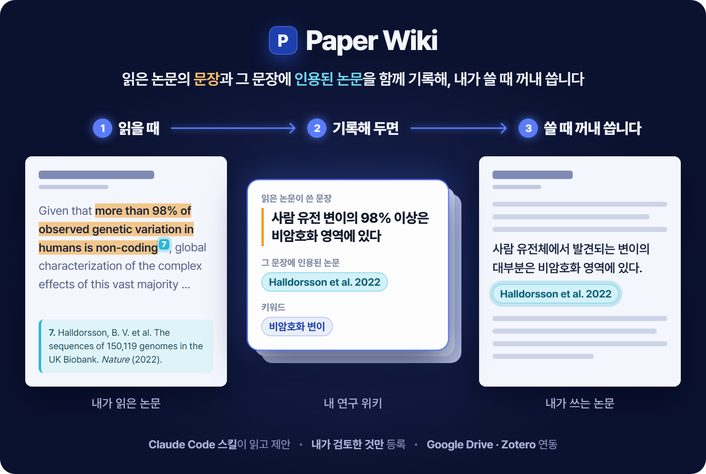
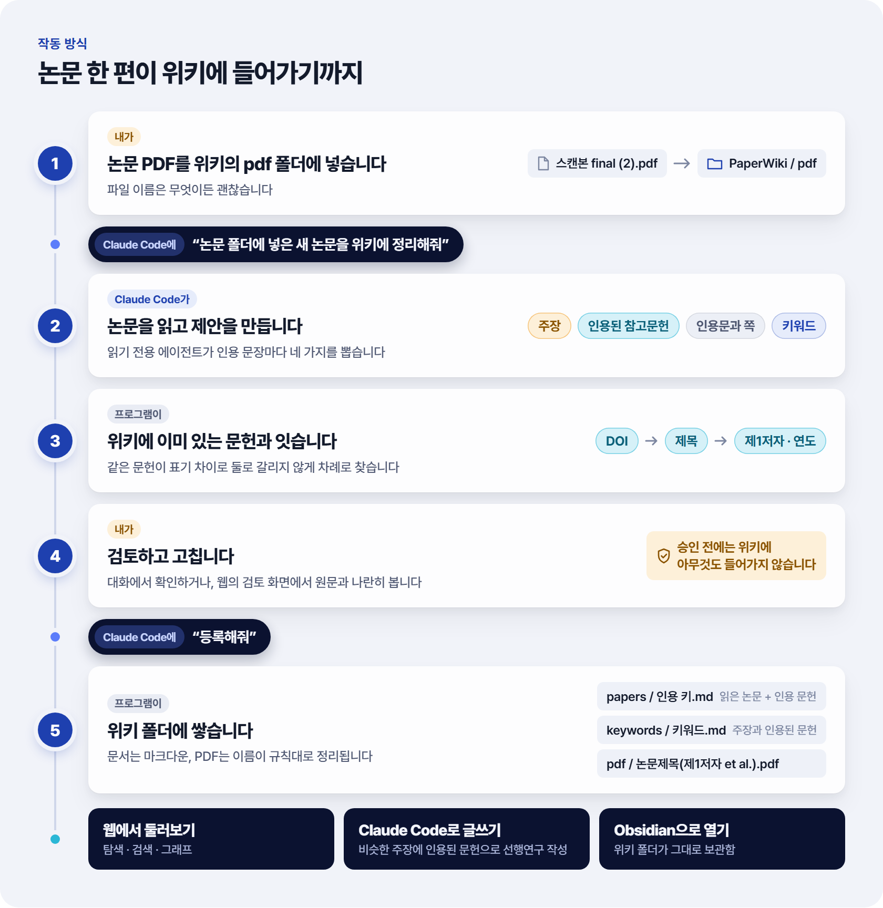
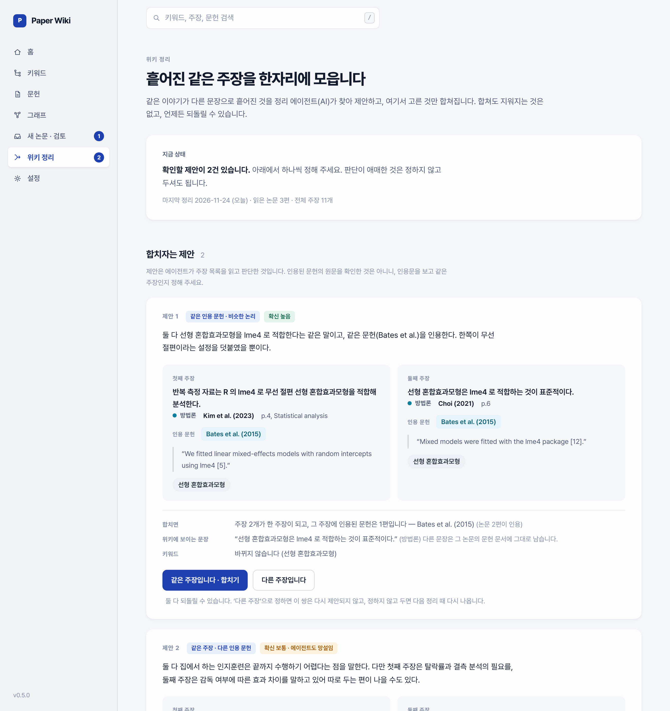

# Paper Wiki

**읽은 논문이 다른 문헌을 인용하며 쓴 문장을, 인용된 문헌과 함께 기록해 둡니다. 내가 논문을 쓸 때 그 기록에서 꺼내 씁니다.**

### 내가 읽은 <mark>논문에 인용된 논문을 활용해</mark> 인용 & 논문 탐색이 가능한 나만의 wiki 만들기

<p align="center">
  <a href="https://youtu.be/rkaOdizPbmI"></a>
  <br>
  <a href="https://youtu.be/rkaOdizPbmI"><b>▶ 소개 영상 보기</b></a> (YouTube · 2분 21초)
</p>

> 누구나 자유롭게 이용할 수 있지만 **상업적 이용은 할 수 없습니다** — [PolyForm Noncommercial 1.0.0](LICENSE), 자세한 내용은 [라이선스](#라이선스).

논문 PDF를 폴더에 넣으면 **Claude Code**가 읽고, 그 논문이 **다른 문헌을 인용하며 한 주장**과 **그 주장에 인용된 문헌**을
뽑아 **키워드(온톨로지)** 별로 정리합니다. 직접 검토해 승인한 것만 개인 위키에 쌓입니다.

분석하는 것은 논문 자신의 결과가 아니라 **그 논문의 인용 문장**입니다. 논문 한 편을 넣으면 그 논문이 '읽은 논문'으로 등록되고,
인용 문장마다 "이런 주장 → 이 문헌들을 인용"이 쌓입니다. 논문이 늘수록 이런 것이 보입니다.

- 어떤 주장을 할 때 어떤 문헌을 인용하는가 → 글을 쓸 때 비슷한 주장에 그 문헌을 인용
- 한 문헌이 **여러 방향(키워드)** 으로 인용되는 모습
- 서로 다른 논문이 **같은 주장에 인용한 문헌**

그 밖에

- **일은 Claude Code 안에서** 합니다 — 논문을 위키에 넣기, 위키를 근거로 선행연구 쓰기, 위키 탐색. API 키는 필요 없습니다.
- **웹 화면은 보는 곳**입니다 — 키워드 → 주장 → 인용된 문헌 → 그 문헌이 인용된 다른 주장으로 타고 넘어가며 읽기, 검색, 그래프, 문헌 목록.
- **위키는 폴더 하나**입니다 — 문서(마크다운)와 논문 PDF가 함께 들어 있습니다. 구글 드라이브에 두면 다른 컴퓨터에서 그대로 이어 씁니다.
- **Zotero**와 맞물립니다 — 위키에 등록한 읽은 논문은 Zotero에도 있습니다. 같은 논문이 Zotero에 있으면 그 항목과 연결하고, 없으면 새 항목으로 넣습니다.
- 서지 정보는 **DOI 등록 기록**으로 확인합니다 — PDF에서 읽은 제목·저자를 그대로 믿지 않고, 인용 문헌에도 등록된 DOI를 붙입니다.

## 작동 방식

<p align="center">
  
</p>

<details>
<summary>글로 보기</summary>

1. **내가** 논문 PDF를 위키의 `pdf` 폴더에 넣습니다. 파일 이름은 무엇이든 괜찮습니다.
2. Claude Code에 "논문 폴더에 넣은 새 논문을 위키에 정리해줘"라고 말합니다.
3. **Claude Code가** 논문을 읽고 제안을 만듭니다. 읽기 전용 에이전트가 인용 문장마다 주장 · 인용된 참고문헌 · 인용문과 쪽 · 키워드를 뽑습니다.
4. **프로그램이** 참고문헌마다 위키에 이미 있는 문헌인지 찾아 잇습니다 (DOI → 제목 → 제1저자·연도와 거의 같은 제목).
5. **내가** 검토하고 고칩니다. 대화에서 확인하거나 웹의 검토 화면에서 고칩니다. 승인 전에는 위키에 아무것도 들어가지 않습니다.
6. Claude Code에 "등록해줘"라고 말합니다.
7. **프로그램이** 위키 폴더에 쌓습니다: `papers/<인용 키>.md` (읽은 논문 + 인용 문헌), `keywords/<키워드>.md`, `pdf/<논문제목(제1저자 et al.)>.pdf`.
8. 쌓인 위키는 웹에서 탐색 · 검색 · 그래프로 보고, Claude Code로 선행연구를 쓰고, Obsidian으로도 엽니다.

</details>

## 준비물

| 무엇 | 왜 필요한가 |
|---|---|
| Python 3.10 이상 | 프로그램 실행 |
| [Claude Code](https://claude.com/claude-code) | 논문을 읽고 위키에 넣는 일, 선행연구 작성. 평소 쓰는 Claude Code 그대로이며 따로 입력할 키가 없습니다. 위키를 보기만 하는 컴퓨터에는 없어도 됩니다. |
| [구글 드라이브 데스크톱](https://www.google.com/drive/download/) | 위키를 구글 드라이브에 두고 여러 컴퓨터에서 이어 쓸 때. 쓰려는 구글 계정으로 로그인해 둡니다. 없으면 설정 화면이 설치를 안내합니다. 이 컴퓨터에만 저장할 거라면 필요 없습니다. |
| [Zotero](https://www.zotero.org/download/) 10 이상 (권장) | 읽은 논문을 Zotero 항목과 연결하고, 없는 논문을 Zotero에 넣습니다. 7~9는 연결(읽기)만 됩니다. 없어도 PDF만으로 위키를 만들 수 있습니다. |

## 설치

두 가지 방법이 있습니다. Claude Code를 이미 쓰고 있다면 첫 번째가 가장 쉽습니다.

### 방법 1 — Claude Code에게 맡기기

Claude Code를 열고 이렇게 말합니다.

```
https://github.com/keras9496/paper-wiki 를 설치하고 위키를 세팅해줘
```

Claude Code가 저장소를 내려받아 설치하고, 위키를 어디에 둘지(구글 드라이브의 어느 계정 또는 이 컴퓨터) 물어본 뒤, 위키와 스킬 설정까지 마칩니다.
끝나면 **새 Claude Code 세션**을 열어 "논문 폴더에 넣은 새 논문을 위키에 정리해줘"처럼 쓰면 됩니다.

<details>
<summary>Claude Code가 따르는 순서 (이 순서대로 직접 해도 됩니다)</summary>

1. **내려받기** — 계속 둘 곳에 받습니다. 따로 정해 준 곳이 없으면 사용자의 홈 폴더 아래 `paper-wiki` 로 받습니다. 설치한 뒤 이 폴더를 옮기면 다시 설치해야 합니다.
   git이 없으면 GitHub의 `Code → Download ZIP` 으로 받아 풀어도 됩니다.
   ```
   git clone https://github.com/keras9496/paper-wiki.git
   cd paper-wiki
   ```
2. **설치** — 내려받은 폴더 안에서, 웹 화면을 띄우지 않는 방식으로 실행합니다 (그냥 실행하면 웹 화면이 떠서 끝나지 않습니다).
   Python 3.10 이상이 필요합니다. 없으면 설치 프로그램이 알려 주고 멈추니, 사용자에게 Python을 설치해 달라고 합니다. 관리자 권한은 필요 없고, 이 폴더 안에 전용 환경(`.venv`)을 만들 뿐입니다.
   ```
   Windows       powershell -NoProfile -ExecutionPolicy Bypass -File install.ps1 -NoLaunch
   macOS/Linux   sh install.sh
   ```
   이후 명령의 `paperwiki` 는 내려받은 폴더의 `.venv\Scripts\paperwiki.exe` (Windows) 또는 `.venv/bin/paperwiki` (macOS·Linux) 입니다. 전체 경로로 실행합니다.
   인자 없이 `paperwiki` 만 실행하면 웹 화면이 떠서 끝나지 않으므로, 설치 중에는 아래 명령만 씁니다.
3. **저장 위치 후보 보기** — 구글 드라이브 데스크톱에 로그인된 계정마다의 위치와, 이 컴퓨터의 문서 폴더가 경로와 함께 나옵니다. 이미 만들어 둔 위키가 있으면 "기존 위키"로 표시됩니다.
   구글 드라이브 데스크톱이 없거나 로그인되어 있지 않으면 그 사실과 내려받는 주소가 함께 나옵니다.
   ```
   paperwiki setup --list          (--json 을 붙이면 JSON)
   ```
   **어디에 둘지는 사용자에게 물어서 정합니다.** 기존 위키가 있으면 새로 만들지 말고 그 위키를 쓸지 먼저 묻습니다.
4. **저장 위치 정하기 + 스킬 설치** — 고른 경로를 넘깁니다. 기존 위키의 경로면 파일을 바꾸지 않고 그대로 불러옵니다.
   ```
   paperwiki setup --vault "<고른 폴더의 전체 경로>" --skill
   ```
5. **점검** — `위키 폴더` 줄이 `정상`, `Claude 스킬` 줄이 `설치됨`이면 설치가 끝난 것입니다. `Zotero 연결` 이 `연결 안 됨`이어도 위키는 쓸 수 있습니다.
   ```
   paperwiki doctor
   ```
6. **사용자에게 알릴 것**
   - 스킬은 새 Claude Code 세션부터 보입니다 (또는 `/reload-skills`).
   - 읽을 논문 PDF는 위키 폴더 안의 `pdf` 폴더에 넣습니다.
   - 웹 화면은 바탕화면의 `Paper Wiki` 바로가기(Windows)나 `paperwiki` 명령으로 엽니다.
   - Zotero를 쓴다면: Zotero의 `설정 → 고급 → "이 컴퓨터의 다른 애플리케이션이 Zotero와 통신하도록 허용"` 을 켠 뒤 `paperwiki zotero connect` 를 실행하고, Zotero에 뜨는 확인 창에서 **항상 허용**을 누릅니다. 이 창은 사용자가 직접 눌러야 합니다.

</details>

### 방법 2 — 직접 설치하기

먼저 이 저장소를 내려받습니다 — GitHub의 `Code → Download ZIP` 으로 받아 압축을 풀거나, `git clone https://github.com/keras9496/paper-wiki.git`.

**Windows** — 내려받은 폴더의 `install.bat` 을 더블클릭합니다.
전용 환경(`.venv`)을 만들고, 바탕화면에 `Paper Wiki` 바로가기를 만든 뒤 웹 화면을 엽니다.
이후 웹 화면은 바탕화면 바로가기나 `PaperWiki.bat` 으로 엽니다. 검은 창을 닫으면 종료됩니다.

**macOS / Linux** — `sh install.sh` 후 `.venv/bin/paperwiki`.

## 첫 설정 (방법 2로 설치하면 브라우저에 자동으로 열립니다)

| 단계 | 할 일 |
|---|---|
| 1. 저장 위치 | 구글 드라이브 데스크톱에 로그인된 **구글 계정 가운데 사용할 계정**을 고릅니다 (또는 이 컴퓨터에만 저장). 같은 계정으로 다른 컴퓨터에서 이미 만든 위키가 있으면 `기존 위키`로 나타나고 [이 위키 불러오기]로 연결합니다. |
| 2. Claude Code 스킬 | [스킬 설치]를 누릅니다. 스킬 파일과 논문 읽기 에이전트 파일이 사용자 폴더의 `.claude` 안에 설치됩니다. |
| 3. Zotero | Zotero 앱의 `설정 → 고급 → "이 컴퓨터의 다른 애플리케이션이 Zotero와 통신하도록 허용"` 을 켜고 [연결 테스트]. 이어서 터미널에서 `paperwiki zotero connect` 를 실행하고 Zotero에 뜨는 확인 창에서 **항상 허용**을 누릅니다 (논문을 Zotero에 넣기 위한 허용, 컴퓨터마다 한 번). |

## 사용 방법

### 논문을 위키에 넣기

1. 읽을 논문 PDF를 위키 폴더 안의 **`pdf` 폴더**에 넣습니다. 파일 이름은 무엇이든 괜찮습니다.
2. Claude Code를 열고(어느 폴더에서든) 요청합니다.
   - "논문 폴더에 넣은 새 논문을 위키에 정리해줘"
   - "이 PDF 위키에 넣어줘: `C:\Users\…\Downloads\paper.pdf`" — 위키 밖의 파일은 논문 폴더로 복사됩니다.
   - "이 주소의 논문 위키에 넣어줘: https://…/paper.pdf" — 공개된 PDF 주소면 내려받아 넣습니다.
   - "Zotero에 있는 ○○ 논문 위키에 넣어줘" — Zotero의 PDF를 논문 폴더로 가져옵니다.
3. Claude Code가 논문마다 **검토안**을 보여 줍니다: 서지 정보, 바뀔 PDF 이름, 주장마다 문장·인용 문헌·근거 인용문과 쪽·키워드,
   이미 위키에 있어 인용 기록이 더해지는 문헌, 새로 만들어질 키워드, 확인할 점.
   고칠 곳을 말하면 고쳐서 다시 보여 줍니다 ("3번 주장은 빼줘", "7번의 인용 문헌을 29번으로 바꿔줘", "이 키워드는 '작업기억' 아래로").
   주장이 수십 개면 한 줄씩 줄여 보여 주고, 인용문 대조는 웹의 **새 논문 · 검토**에서 PDF와 나란히 할 수 있습니다.
4. "등록해줘"라고 하면 논문이 **읽은 논문**으로, 주장에 인용된 참고문헌이 **인용 문헌**으로 등록되고(이미 있는 문헌에는 연결),
   **PDF 이름이 규칙대로 바뀝니다.** 인용 문헌으로만 있던 논문의 PDF를 나중에 넣으면 그 문서가 읽은 논문으로 바뀝니다.

주장은 "읽은 논문이 그 문헌을 그렇게 인용했다"는 기록입니다. 인용된 문헌의 원문을 확인한 것은 아니므로, 중요한 인용은 원문을 확인하세요.

> 처음에는 Claude Code가 이 스킬을 쓰고 `paperwiki` 명령을 실행해도 되는지 묻습니다. "다시 묻지 않음"을 고르면 다음부터는 묻지 않습니다.
> 논문을 읽는 에이전트는 파일 읽기·쓰기 도구만 가지며, 명령 실행이나 웹 접근은 할 수 없습니다.
> 읽기 에이전트는 Claude Code 대화에서 어떤 모델을 쓰고 있든 **Claude Sonnet**으로 읽습니다. 다른 모델로 읽히려면 `paperwiki reader-model opus` 처럼 바꿉니다.

### PDF 이름 규칙

등록된 논문의 PDF는 한 가지 규칙으로 이름이 바뀝니다. 기본은 **`논문제목(제1저자 et al.).pdf`** 입니다 (저자가 한 명이면 `논문제목(저자).pdf`).

```
스캔본 final (2).pdf   →   Computerized cognitive training improves working memory in mild cognitive impairment(Kim et al.).pdf
```

- 사용자가 `pdf` 안에 만든 하위 폴더는 그대로 두고, 그 안에서 이름만 바꿉니다.
- 규칙은 웹의 설정 → 저장 위치 → **PDF 이름 규칙 [바꾸기]** 에서 바꿉니다 (예: `{author} {year} - {title}`). 바꾸면 이미 등록된 PDF에도 적용됩니다.
- PDF가 다른 프로그램에서 열려 있어 이름을 바꾸지 못하면 등록은 그대로 되고, 나중에 `paperwiki tidy` 로 다시 맞춥니다.
  등록된 PDF를 손으로 옮기거나 이름을 바꿨을 때도 `paperwiki tidy` 가 내용으로 찾아 다시 연결합니다.

### 위키를 근거로 선행연구 쓰기

원고가 있는 폴더에서 Claude Code를 열고 요청합니다.

- "이 문장에 인용할 문헌을 위키에서 찾아 넣어줘. 인용은 `[@citekey]` 형식으로."
- "위키에서 전산화 인지훈련의 효과를 말할 때 인용하는 문헌 찾아줘"
- "혼합효과모형을 쓴다고 쓸 때 보통 무엇을 인용하지?"

쓰려는 주장과 비슷한 주장을 위키에서 찾아 **그 주장에 인용된 문헌**을 인용합니다. 여러 논문이 같은 주장에 인용한 문헌을 먼저 쓰고,
원문을 읽지 않은 문헌(인용 문헌)이 무엇인지와 위키에 근거가 없어 쓰지 못한 부분을 알려 줍니다. 지어내지 않습니다.
인용 키는 같은 논문이 Zotero에 있으면 Zotero의 인용 키와 같습니다.

### 위키 탐색

- **웹** (`Paper Wiki` 바로가기): 키워드 트리 → 키워드 문서(주장과 주장마다 인용된 문헌, 자주 인용되는 문헌, 같은 문헌이 인용된 다른 키워드)
  → 문헌 문서(이 문헌이 어떤 주장에, 어떤 방향으로, 어떤 논문에서 인용되었는지) → 원문 PDF.
  문헌 목록은 많이 인용된 순·여러 방향으로 인용된 순으로 볼 수 있습니다. 검색, 그래프. 키워드 이름 바꾸기·옮기기·병합과 주장 수정도 여기서 합니다.
- **Claude Code**: "내 위키에서 여러 논문이 인용한 문헌과 여러 방향으로 인용된 문헌을 정리해줘", "작업기억 키워드를 훑어보고 빈틈을 찾아줘"
- **Obsidian**: "폴더를 보관함으로 열기" → 위키 폴더. 각 문서 맨 아래 **메모** 영역에 적은 내용은 문서가 다시 만들어져도 보존됩니다.

### 위키 정리 (dream cycle) — 흩어진 같은 주장 모으기

논문은 한 편씩 읽고 정리하므로, 논문이 늘수록 같은 이야기가 다른 문장으로 여러 자리에 흩어집니다. 같은 말인데 문장이 달라 따로 놓이면
"이 주장에는 보통 이 문헌들을 인용한다"가 한눈에 보이지 않습니다. 그래서 정리 에이전트(Claude Opus)가 위키 전체를 읽고
**같은 주장으로 합칠 것을 제안**하고, 사용자가 고른 것만 합칩니다.
[GBrain](https://github.com/garrytan/gbrain)의 dream cycle(쉬는 동안 기억을 정리하는 주기)에서 가져온 생각입니다.

Claude Code에 이렇게 요청합니다.

> 위키 정리해줘

에이전트는 두 가지를 찾습니다.

1. **같은 문헌이 비슷한 논리로 인용됐는데, 문장이 달라 서로 다른 자리에 놓인 것** — 한 문헌이 정말 여러 방향으로 쓰이는지, 표현만 달랐던 것인지가 가려집니다.
2. **서로 다른 문헌을 인용하며 같은 주장을 했는데 따로 나뉘어 있는 것** — 합치면 그 주장에 인용되는 문헌이 한곳에 모여, 글을 쓸 때 고를 수 있는 인용이 늘어납니다.
   (한 논문이 본문과 그림 설명에서 같은 말을 두 번 한 것도 여기에 걸립니다.)

<p align="center">
  
</p>

정하는 것은 사용자입니다. 대화에서 "1번만 합쳐줘", "2번은 다른 주장이야", "2번은 나중에 볼게"라고 말해도 되고, 웹의 **위키 정리** 화면에서
두 주장을 나란히 보며 단추로 정해도 됩니다. 어느 쪽에서 정하든 같은 곳에 반영됩니다.

- **제안만 만들고, 정한 것만 반영합니다.** 제안마다 이유, 두 주장의 문장 · 논문 · 쪽 · 인용 문헌 · 원문 인용문, 합치면 위키에 어떻게 보이는지를 보여 줍니다.
  에이전트는 주장 목록만 읽고 판단하므로(인용된 문헌의 원문은 보지 않습니다), 에이전트도 망설인 제안에는 "확신 보통"이라고 표시합니다.
- **에이전트가 합치지 않기로 한 것도 볼 수 있습니다.** 비슷해 보여 따져 봤지만 다른 주장으로 본 것("살펴봤지만 합치지 않은 것")을 이유와 함께 남깁니다.
  정할 제안이 묻히지 않도록 접혀 있고("살펴본 것도 보여줘"라고 하거나 화면에서 펼칩니다), 같은 주장이라고 보면 그 자리에서 합칠 수 있습니다.
  합칠 제안이 하나도 없을 때는 이 목록이 그대로 나와, 합칠 것이 없다는 결과에도 근거가 보입니다.
- **합쳐도 아무것도 지워지지 않습니다.** 주장들이 한 묶음이 될 뿐, 각 주장의 문장 · 인용문 · 쪽 · 인용 문헌은 그대로 남습니다.
- **모두 되돌릴 수 있습니다.** 합친 것은 합친 기록에서, '다른 주장'으로 정한 것은 그 목록에서 되돌립니다. '다른 주장'으로 정한 쌍은 다시 제안되지 않고,
  정하지 않고 둔 제안은 다음 정리 때 다시 나옵니다.
- **때가 되면 알려 줍니다.** 마지막 정리 뒤에 논문이 늘었고 일주일이 지났으면, 논문을 등록한 뒤와 웹의 홈 · 위키 정리 화면에 "정리할 때가 되었습니다"가 나옵니다.
  스스로 돌지는 않습니다 — 정리는 사용자가 요청할 때 시작합니다.

```
paperwiki dream                      정리할 때가 됐는지, 기다리는 제안이 있는지
paperwiki dream review [--near|--full]   검토 요약 다시 보기 (--near: 살펴본 것도 · --full: 논문 · 위치 · 인용 문헌까지)
paperwiki dream apply [--only 1,3]   제안을 같은 주장으로 합치기
paperwiki dream reject 2             다른 주장으로 정해 두기 (다시 제안되지 않음)
paperwiki dream merge 4              에이전트가 다르다고 본 것("살펴본 것")을 같은 주장으로 합치기
paperwiki dream done                 검토 마치기
paperwiki dream undo [기록 id]        합친 것 되돌리기 · paperwiki dream history 로 기록 보기
paperwiki dream apart [--forget 1]   다른 주장으로 정해 둔 쌍 보기 · 되돌리기
paperwiki dream model [모델]          정리 에이전트의 모델 보기 · 바꾸기 (기본 opus)
```

## 다른 컴퓨터에서 이어 쓰기

로그인 토큰이나 서버 없이, 각 프로그램이 원래 하던 동기화에 맡깁니다.

| 무엇을 | 어떻게 동기화되나 | 두 번째 컴퓨터에서 할 일 |
|---|---|---|
| 위키 (주장·키워드·검토 대기·위키 정리의 제안과 기록·메모) **와 논문 PDF** | 구글 드라이브 데스크톱 | 같은 구글 계정으로 로그인 → 첫 설정에서 [이 위키 불러오기] |
| 프로그램 (이 폴더) | 복사 또는 git | 폴더를 복사(`.venv` 제외)해 `install.bat` 실행 |
| Claude Code 스킬 | 동기화하지 않음 (위키 경로가 컴퓨터마다 다름) | 설정에서 [스킬 설치] |
| Zotero 라이브러리 (선택) | Zotero 계정 동기화 | Zotero에 같은 계정으로 로그인 |

- 불러오기는 위키의 파일을 바꾸지 않습니다. 기본 폴더(`PaperWiki`)가 아닌 하위 폴더에 만들었어도 찾습니다.
- 기존 위키가 보이지 않으면 드라이브 동기화가 아직 덜 끝난 것일 수 있습니다. 새로 만들지 말고 잠시 뒤 [다시 확인]을 누르세요.
- 한 컴퓨터에서 만들어 둔 검토안은 다른 컴퓨터에서 이어서 검토하고 등록할 수 있습니다.
- 두 컴퓨터에서 **동시에** 같은 논문을 등록하지는 마세요. 동기화가 끝난 뒤 이어서 쓰면 충돌이 없습니다.

## 같은 문헌을 놓치지 않기

이 위키에서 가장 중요한 정보는 "한 문헌이 여러 논문에서, 여러 방향으로 인용된다"는 것입니다. 서로 다른 논문은 같은 문헌을 서로 다르게 적으므로
(부제 유무, 저자 표기, 프리프린트와 출판본, DOI 유무), 그대로 두면 한 문헌이 여러 문서로 갈려 이 정보가 사라집니다. 그래서 네 겹으로 막습니다.

1. **DOI를 기준으로 삼습니다.** 논문을 넣을 때 인용 문헌마다 DOI를 붙입니다 — 출판사가 등록한 참고문헌 목록에서 찾고, 없으면 Crossref에서
   제목·제1저자·연도로 찾습니다. DOI가 같으면 제목이 어떻게 적혀 있든 같은 문헌입니다.
2. **DOI가 없거나 달라도 같은 논문이면 잇습니다.** 제목이 같은 것(대소문자·구두점·발음 기호·`&`/and·그리스 문자 표기 차이는 무시),
   제1저자·연도가 같고 제목에 부제나 분류어만 더 붙은 것, 같은 논문의 프리프린트와 출판본, 한 논문에 DOI가 둘 등록된 것.
3. **한 번 이어진 표기는 기억합니다.** 같은 문헌의 다른 제목·다른 DOI를 문헌에 적어 두어, 다음에 그 표기로 인용되면 바로 이어집니다.
4. **확신할 수 없으면 조용히 나누지 않고 묻습니다.** 검토안에 "같은 문헌일 수 있는 것"으로 올라오고, 등록한 뒤에는 `paperwiki duplicates` 에 나옵니다.

검토안에서 "같은 문헌일 수 있는 것"이 나오면 Claude Code에 "9번은 @hill2017… 과 같은 문헌이야" 또는 "다른 문헌이야"라고 말하면 됩니다.
표기가 다른데 자동으로 이은 것에는 "같은 문헌으로 본 근거"가 함께 나오므로 잘못 이은 것도 그 자리에서 잡을 수 있습니다.

```
paperwiki duplicates                 같은 문헌이 둘로 갈렸을 수 있는 쌍 (인용이 많이 걸린 쌍부터)
paperwiki duplicates --merge         같은 문헌이라는 근거가 분명한 쌍(같은 DOI 등)을 합치기
paperwiki duplicates --find-dois     DOI 없이 등록된 문헌의 DOI를 다시 찾기 (한 편에 1~2초)
paperwiki duplicates --apart @a @b   비슷해 보이지만 다른 문헌 — 다시 묻지 않음
paperwiki merge-papers @a @b         확인한 쌍을 합치기 (@a 를 @b 로)
```

한계도 있습니다. 참고문헌 목록에 제목이 없는 학술지, 제목이 바뀐 프리프린트와 출판본, 학회 발표와 학술지 논문처럼 제목·DOI·연도가 모두 다른 경우는
자동으로 잇지 못하고 후보로도 안 나올 수 있습니다. 이런 것은 문헌 문서를 보다가 발견하면 `merge-papers` 로 합치면 되고, 합친 표기는 기억됩니다.
밖으로 보내는 것은 논문의 DOI(doi.org)와 참고문헌의 제목·제1저자 성(Crossref)뿐입니다. `paperwiki propose <id> --no-lookup` 으로 끌 수 있습니다.

## Zotero 연동

위키에 등록한 **읽은 논문**은 Zotero에도 있는 논문이 되도록 맞춥니다. 인용 문헌(참고문헌으로만 아는 논문)은 Zotero에 넣지 않습니다.

- 논문을 등록할 때 **같은 논문이 Zotero에 있으면**(DOI 또는 제목이 일치) 그 항목과 연결하고, 그 서지 정보와 인용 키를 씁니다.
- **Zotero에 없으면 새 항목으로 넣습니다.** 서지 정보는 DOI 등록 기록(권·호·쪽 포함)에서 오고, 위키의 인용 키가 Zotero의 인용 키가 되며,
  위키 논문 폴더의 PDF가 **링크된 파일**로 붙습니다 (PDF는 한 곳에만 있고, Zotero의 파일 저장 공간을 쓰지 않습니다).
- 위키에 있는 논문은 Zotero의 **`Paper Wiki` 컬렉션**에 모입니다.
- 논문 문서에는 "Zotero에서 열기" 링크가 붙고, 위키에서 PDF 이름이 바뀌면 Zotero의 PDF 링크도 따라 바뀝니다.
- Zotero가 꺼져 있을 때 등록하면 위키에만 들어갑니다. Zotero를 켠 뒤 `paperwiki zotero sync` 를 실행하면 이어서 넣습니다.
- Zotero에만 있는 논문은 "Zotero에 있는 ○○ 논문 위키에 넣어줘"로 PDF를 논문 폴더에 가져옵니다.

**허용은 Zotero가 직접 묻습니다.** `paperwiki zotero connect` 를 실행하면 Zotero가 "Paper Wiki가 라이브러리를 수정하려 합니다"라는 확인 창을 띄웁니다.
**항상 허용(Always Allow)** 을 누르면 그 컴퓨터에서 계속 쓸 수 있습니다. zotero.org의 API 키는 필요 없고, 받은 허용 키는 OS 자격 증명 저장소에만 있습니다.
허용을 거두려면 Zotero의 `설정 → 고급 → Clear Write Authorizations`.

Paper Wiki가 Zotero에서 하는 일은 셋뿐입니다: 새 항목(과 그 PDF 링크) 만들기, `Paper Wiki` 컬렉션에 넣기, 자신이 만든 PDF 링크의 경로 고치기.
기존 항목의 내용을 바꾸거나 지우지 않습니다. 위키에서 논문을 지워도 Zotero의 항목은 그대로 둡니다.

```
paperwiki zotero config                       지금 설정 보기
paperwiki zotero config --add off             Zotero에 넣지 않기 (찾아서 연결만)
paperwiki zotero config --collection "읽은 논문"   모아 둘 컬렉션 이름 ("" 이면 컬렉션을 쓰지 않음)
paperwiki zotero config --pdf none            PDF를 Zotero 항목에 링크하지 않기
```

- PDF 링크는 이 컴퓨터의 경로(예: `G:\내 드라이브\PaperWiki\pdf\…`)로 저장됩니다. 다른 컴퓨터에서 드라이브 경로가 다르면
  Zotero의 `설정 → 고급 → 파일 및 폴더 → 링크된 첨부 파일 기본 폴더`를 각 컴퓨터의 위키 `pdf` 폴더로 지정하세요. 그러면 Zotero가 상대 경로로 저장합니다.
  (위키 쪽의 "PDF 열기"는 경로와 상관없이 어느 컴퓨터에서나 열립니다.)
- 여러 컴퓨터에서 같은 "Zotero에서 열기" 링크와 인용 키를 쓰려면 Zotero 앱을 같은 Zotero 계정으로 로그인해 두세요 (Zotero 설정 → 동기화).

## 안전하게 관리되는 것들

- **AI용 API 키를 쓰지 않습니다.** 논문을 읽는 것은 사용자가 로그인해 둔 Claude Code이고, 이 프로그램은 Claude Code의 로그인 정보를 다루지 않습니다. 사용량은 각자의 Claude Code 요금제에서 쓰입니다.
- **검토 없이 등록하지 않습니다.** 논문을 읽은 결과는 먼저 "검토 대기"로만 저장되고, 스킬은 사용자가 검토안을 보고 등록하라고 한 뒤에만 등록하도록 되어 있습니다. 웹의 검토 화면에서도 [승인]을 눌러야 저장됩니다.
- **검토 없이 합치지 않습니다.** 위키 정리의 에이전트는 읽기·쓰기 도구만 가진 채 제안 파일 하나를 쓸 뿐이고, 주장이 실제로 합쳐지는 것은 사용자가 고른 제안뿐입니다. 합친 것은 기록되어 되돌릴 수 있습니다.
- **논문 본문은 분석 대상일 뿐입니다.** PDF 안에 AI에게 내리는 지시처럼 보이는 문장이 있어도 따르지 않고, 있었다는 사실을 검토안의 "확인할 점"에 적습니다.
- **구글 드라이브 로그인 정보를 다루지 않습니다.** 동기화는 구글 드라이브 데스크톱이 하고, 프로그램은 그 폴더에 파일을 쓸 뿐입니다.
- 위키 파일을 다 읽을 수 없는 상태(동기화 중·오프라인)에서는 등록·수정·이름 바꾸기를 모두 멈춥니다. 일부만 읽힌 채 저장해 위키가 어긋나는 일을 막기 위해서입니다.
- 웹 화면은 `127.0.0.1` 에서만 열리며, 다른 웹사이트가 브라우저를 통해 보내는 요청은 거부합니다.
- **프로그램이 인터넷에 연결하는 곳은 정해져 있습니다.** 위키의 내용이나 사용자 정보는 어디로도 보내지 않습니다.
  - `doi.org` — 논문의 DOI로 서지 정보 확인 (보내는 것: DOI)
  - `api.crossref.org` — 인용 문헌의 DOI 찾기 (보내는 것: 참고문헌의 제목과 제1저자 성)
  - `cdn.jsdelivr.net` — 웹 화면의 글꼴(Pretendard)을 브라우저가 불러옵니다 (글꼴 파일을 받아 올 뿐 위키 내용은 보내지 않습니다. 연결이 안 되면 기본 글꼴로 보입니다)
  - 사용자가 준 논문 주소(URL) — 그 PDF를 내려받을 때
  - `api.zotero.org` — Zotero 연결 방식을 직접 '웹'으로 바꾸고 자신의 API 키를 넣은 경우에만. 기본은 이 컴퓨터의 Zotero 앱과만 통신합니다.

## 위키 폴더 구조

```
PaperWiki/
  index.md                 전체 목차
  CLAUDE.md                Claude Code 용 안내
  papers/<인용 키>.md       문헌 문서 — 읽은 논문(status: read)과 인용 문헌(status: cited).
                           이 문헌을 인용해 할 수 있는 주장 · (읽은 논문이면) 이 논문이 문헌을 인용하며 한 주장
  keywords/<키워드>.md      키워드 문서 (주장과 인용된 문헌, 자주 인용되는 문헌, 상·하위, 같은 문헌이 인용된 다른 키워드)
  pdf/                     논문 폴더 — 새 PDF 를 넣는 곳. 등록된 PDF 는 규칙대로 이름이 바뀌어 있음
  .paperwiki/              원본 데이터(JSON) — 직접 수정하지 않음
    ontology.json  papers/  pending/  vault.json
    dream/                 위키 정리: 열려 있는 검토안, 합친 기록(되돌리기용), 다른 주장으로 정해 둔 쌍
```

## 명령어

Claude Code의 스킬이 쓰는 명령입니다. 직접 실행해도 됩니다 (`.venv\Scripts\paperwiki.exe`).

```
paperwiki                         웹 화면 실행
paperwiki inbox                   논문 폴더의 새 PDF 와 검토 대기 목록
paperwiki prepare "<PDF | URL>"   읽을 준비 (작업 지시 파일을 만든다)
paperwiki propose <id>            제안을 검토안으로 저장하고 검토 요약 출력
paperwiki review <id> [--compact]  검토 요약 다시 보기 (--compact: 주장마다 한 줄, 인용문 생략)
paperwiki approve <id>            검토안을 위키에 등록 (인용 문헌이 함께 등록·연결되고, PDF 이름이 규칙대로 바뀜)
paperwiki discard <id>            검토안 폐기 (PDF 는 그대로)
paperwiki zotero list "<검색어>"   Zotero 라이브러리 검색
paperwiki zotero pull <항목 키>    Zotero 의 PDF 를 논문 폴더로 가져오기
paperwiki zotero connect          Zotero 에 넣기 허용받기 (Zotero 의 확인 창에서 '항상 허용', 컴퓨터마다 한 번)
paperwiki zotero sync [--dry-run] 위키의 읽은 논문을 Zotero 와 맞추기 (있으면 연결, 없으면 새 항목으로 넣기)
paperwiki zotero config           Zotero 에 넣기 설정 (--add on|off, --collection "이름", --pdf link|none)
paperwiki search "작업기억"        위키 검색: 주장마다 인용된 문헌과 그렇게 인용한 논문 (--json 가능)
paperwiki show "LMM"              키워드(이름·별칭) 또는 @인용키 의 문서 출력
paperwiki tree                    키워드 온톨로지
paperwiki papers [--read|--cited] [--sort cited|directions]   문헌 목록 (많이 인용된 순 · 여러 방향으로 인용된 순)
paperwiki insights                여러 논문이 인용한 문헌 · 여러 방향으로 인용된 문헌 · 같은 주장에 함께 인용된 문헌
paperwiki same <묶음 id> <묶음 id>  서로 다른 논문의 주장을 같은 주장으로 묶기 (--undo 로 떼어 내기)
paperwiki dream [review|apply|reject|merge|done|undo|history|apart|model]   위키 정리 (위의 "위키 정리" 참고)
paperwiki duplicates              같은 문헌이 둘로 갈렸을 수 있는 쌍 찾기 (--merge, --find-dois, --apart @a @b)
paperwiki merge-papers @<없앨 쪽> @<남길 쪽>   표기 차이로 둘이 된 같은 문헌 합치기 (합친 표기는 기억됨)
paperwiki tidy                    논문 폴더 정리 (이름 맞추기, 옮겨진 PDF 다시 연결, 이어서 zotero sync)
paperwiki fix @<인용 키> --title … --authors "Kim, Jisoo; Lee, Sang" --year … --venue … --doi …
paperwiki naming ["<규칙>"]        PDF 이름 규칙 보기 · 바꾸기
paperwiki reader-model [모델]      논문 읽기 에이전트의 모델 보기 · 바꾸기 (기본 sonnet. opus · haiku · inherit · 모델 ID)
paperwiki doctor                  설정·연결 상태 점검
paperwiki setup [--list] [--vault "<폴더>"] [--skill]   위키 저장 위치 보기 · 정하기 (--skill: 스킬도 함께 설치)
paperwiki claude-install / rebuild
```

## 문제 해결

| 증상 | 확인할 것 |
|---|---|
| Claude Code가 "paper-wiki" 스킬을 모른다 | 웹의 설정에서 [스킬 설치]. 설치 직후에도 안 보이면 Claude Code에서 `/reload-skills` 또는 새 세션 |
| Claude Code가 명령 실행 허용을 계속 묻는다 | 허용 창에서 "다시 묻지 않음"을 고릅니다 |
| "이 PDF 는 이미 위키에 등록되어 있습니다" | 같은 파일이 이미 등록됨. 다시 분석하려면 "이 논문 다시 분석해줘" (`prepare --again`) |
| "받은 파일이 PDF 가 아닙니다" | 로그인·구독이 필요한 주소입니다. 브라우저로 PDF를 받아 `pdf` 폴더에 넣으세요 |
| "PDF 이름을 바꾸지 못했습니다" | PDF가 다른 프로그램에서 열려 있습니다. 닫고 `paperwiki tidy` |
| 웹에서 "PDF 파일을 찾을 수 없습니다" | 다른 컴퓨터에서 넣은 논문이면 드라이브 동기화를 기다립니다. 파일을 옮겼다면 `paperwiki tidy` |
| "위키 폴더를 찾을 수 없습니다" | 구글 드라이브 데스크톱이 실행·로그인되어 있는지 확인 |
| "위키 파일을 아직 다 읽을 수 없습니다" | 드라이브가 동기화 중이거나 오프라인입니다. 동기화가 끝난 뒤 다시 시도 |
| "Zotero 앱에 연결하지 못했습니다" | Zotero가 실행 중인지, `설정 → 고급 → 다른 애플리케이션 통신 허용`이 켜져 있는지 확인. 꺼진 채 등록한 논문은 `paperwiki zotero sync` 로 나중에 넣습니다 |
| "Zotero 가 아직 … 항목 추가를 허용하지 않았습니다" | Zotero를 켠 채 `paperwiki zotero connect` → Zotero의 확인 창에서 **항상 허용** |
| 웹 화면에 "프로그램이 업데이트되었습니다" | 프로그램은 새것인데 화면을 보여 주는 서버가 예전 것입니다. 터미널에서 `paperwiki` 를 다시 실행하면 새 버전으로 바뀝니다 |
| 위키 정리에서 "상태 파일을 읽을 수 없습니다" | 드라이브가 동기화 중이거나 두 컴퓨터의 변경이 충돌했습니다. 동기화가 끝난 뒤 다시 시도 (읽을 수 없는 채로 덮어써서 '다른 주장'으로 정해 둔 것이 사라지지 않게 멈춘 것입니다) |
| 합친 것을 되돌리려는데 "그것부터 되돌려 주세요" | 같은 주장을 나중에 다시 합친 기록이 있습니다. 나중 것부터 되돌려야 묶음과 키워드가 제자리로 돌아갑니다 (`paperwiki dream history`) |
| 같은 뜻의 키워드가 여러 개 | 웹의 키워드 문서 → [다른 키워드로 병합] |
| 서지 정보(제목·저자·연도)가 틀렸다 | Claude Code에 "○○ 논문 저자를 …로 고쳐줘" (`paperwiki fix`) |

## 앞으로의 방향

- **위키 정리를 정해진 때에 스스로 시작하기.** 지금은 "정리할 때가 되었습니다"라고 알려 주고 사용자가 요청하면 시작합니다.
  밤사이 에이전트가 제안을 만들어 두고 아침에 검토만 하도록 하는 것이 다음 단계입니다 (합치는 것은 그때도 사용자가 정합니다).
- **정리의 범위 넓히기.** 지금은 같은 주장을 모으는 일만 합니다. 주장 문장이 인용문과 어긋난 것, 이미 묶인 주장 가운데 다른 말이 섞인 것처럼
  에이전트가 읽다가 발견한 것은 메모로만 알려 줍니다 — 이것도 제안으로 만들어 고칠 수 있게 하려 합니다.

## 개발

```
.venv\Scripts\python -m pytest              테스트 (실제 설정·Zotero·~/.claude 를 건드리지 않음)
.venv\Scripts\python tests\demo_server.py   예시 데이터로 화면 둘러보기 (http://127.0.0.1:8799)
                                            --empty: 첫 실행 화면 / --drive=two|off|none: 구글 드라이브 상태 흉내
                                            --no-claude, --no-skill, --existing, --zotero-unlinked, --no-dream
```

코드 구성: `store.py`(데이터) · `library.py`(논문 폴더: 새 PDF, 들여오기, 이름 규칙) · `extract.py`(분석 규칙, 작업 지시문, 제안 형식 검사) ·
`wiki.py`(검토안·승인·키워드 조작·검색) · `dream.py`(위키 정리: 합치기 제안·검토·반영·되돌리기) · `render.py`(마크다운 생성) ·
`integration.py`(Claude Code 스킬·읽기 에이전트·정리 에이전트) ·
`zotero.py` · `gdrive.py`(구글 드라이브 데스크톱 탐지) · `server.py`(웹 화면) · `cli.py`(명령)

## 라이선스

[PolyForm Noncommercial License 1.0.0](LICENSE) 으로 공개합니다.

- **자유롭게 쓸 수 있습니다.** 개인의 공부와 연구, 교육기관·공공 연구기관 등의 비영리 목적이라면 사용·수정·재배포할 수 있습니다.
- **상업적 이용은 할 수 없습니다.**
- 다시 배포할 때는 라이선스 전문(또는 그 주소)과 아래 표기를 함께 전달해야 합니다.

```
Required Notice: Copyright (c) 2026 keras9496 (https://github.com/keras9496/paper-wiki)
```

허용 범위의 정확한 기준은 [LICENSE](LICENSE) 전문입니다. `assets/` 의 기관 로고는 각 기관의 것이며 이 라이선스의 대상이 아닙니다.

## English

**Paper Wiki records the sentences in which the papers you read cite other work, together with the cited references, so you can reuse them when you write.**
Drop a PDF into the wiki folder and ask Claude Code to file it: a read-only agent extracts each citing claim, the references it cites, the quote and page, and keywords. Nothing is saved until you review and approve it. The wiki is a plain folder (Markdown + PDFs) that can live in Google Drive, links read papers to Zotero, and comes with a local web view for browsing, search and a graph. No API key is needed. The interface and documentation are currently in Korean.

**Install with Claude Code**: tell it `Install https://github.com/keras9496/paper-wiki and set up the wiki`. The steps it follows are listed under [설치](#설치): clone, run `install.ps1 -NoLaunch` (Windows) or `sh install.sh`, show the storage options with `paperwiki setup --list` and ask you where the wiki should live, then `paperwiki setup --vault "<folder>" --skill` and `paperwiki doctor`.

**Dream cycle (wiki tidying)**: inspired by [GBrain](https://github.com/garrytan/gbrain). Ask Claude Code to "tidy the wiki" (`위키 정리해줘`) and a Claude Opus agent reads every claim and proposes consolidations — the same reference cited for the same point in differently worded claims, and the same claim made with different references. Nothing is merged until you decide, in chat or on the web page where the two claims sit side by side with their quotes. The near-misses the agent decided against are shown too, so you can overrule it. Merging deletes nothing, and every decision can be undone. The wiki tells you when a tidy-up is due; it does not start one by itself yet.

Free to use, modify and share for noncommercial purposes; **commercial use is not permitted** ([PolyForm Noncommercial 1.0.0](LICENSE)).

## 후원 · Acknowledgements

<p>
  
  &nbsp;&nbsp;
  
</p>

이 프로젝트는 **서울특별시보라매병원 정신건강의학과 SAMD Lab**과 **한양인터칼리지 인지융합과학 프로그램**의 후원으로 개발되었습니다.

This project was developed with the support of the **SAMD Lab, Department of Psychiatry, SMG-SNU Boramae Medical Center**, and **Hanyang YK Intercollege**.
